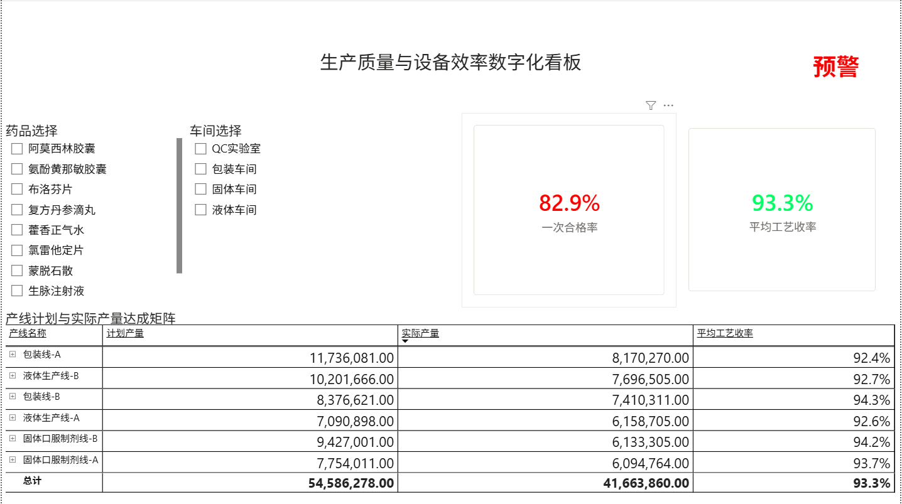
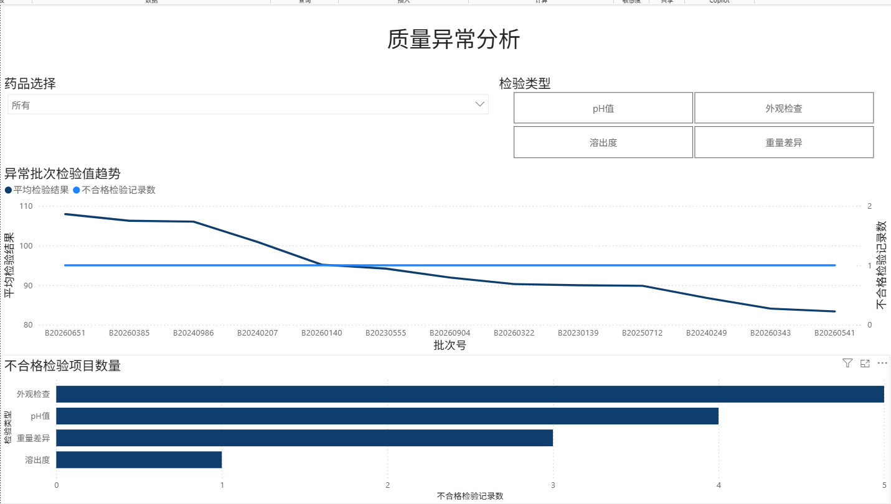
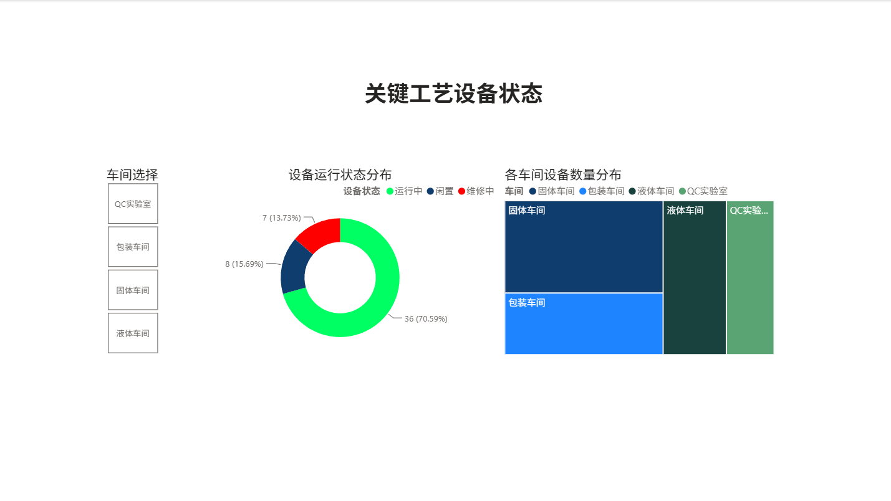

# 制药生产与质量数据分析可视化项目

**Pharmaceutical Manufacturing & Quality Analytics**

## 项目简介

本项目基于制药生产业务场景，使用 MySQL、SQL 和 Power BI 构建模拟生产数据分析与可视化看板。

项目围绕生产批次、产线效能、质量检测和设备运行状态展开，通过 SQL 进行数据关联、统计与异常识别，并使用 Power BI 实现多维度数据展示。

**技术栈：** MySQL 8.0 / SQL / Power BI / DAX

**数据来源：** 基于制药生产业务需求设计数据结构，使用 AI 辅助生成模拟数据及部分代码实现。

## 项目架构

模拟生产数据 → MySQL 数据库 → SQL 分析视图 → Power BI 数据模型 → 可视化看板

数据库包含五张原始数据表：

| 数据表 | 功能 |
|---|---|
| production_records | 生产批次及收率记录 |
| production_lines | 生产线基本信息 |
| drugs | 药品基础信息 |
| quality_inspections | 质量检测记录 |
| equipment | 生产与检测设备信息 |

通过 SQL 构建四个业务分析视图，支持生产绩效、质量异常与设备状态分析。

## 核心功能展示

### 1. 生产效能分析

- 展示一次合格率与平均工艺收率
- 对比各产线计划产量和实际产量
- 支持药品与车间维度筛选

### 2. 质量异常分析

- 展示模拟批次检验结果趋势
- 统计不同检测类型的不合格记录
- 支持药品与检验类型筛选

### 3. 设备状态分析

- 展示运行、闲置和维修状态分布
- 按车间展示设备相关记录
- 辅助理解设备状态信息的可视化表达

## SQL 数据分析

项目主要使用：

- JOIN：关联生产记录与药品、产线信息
- GROUP BY / HAVING：实现分组统计及条件筛选
- CASE WHEN：建立收率异常标识
- CTE：组织多阶段分析逻辑
- 窗口函数：实现产线内批次排序与历史记录分析
- MySQL VIEW：整合业务分析数据，供 Power BI 使用

## 项目文件

| 目录 | 内容 |
|---|---|
| `sql/` | MySQL 表结构、视图定义与模拟数据 |
| `PowerBI/` | Power BI 报表源文件 |
| `Screenshots/` | 三个报表页面截图 |

Power BI 使用 Import 模式保存导入数据。查看现有报表通常无需连接原始 MySQL 数据库，但刷新数据需要重新配置数据源。

## 项目说明与局限性

本项目为个人自主学习与实践作品，未在真实制药生产环境中部署。

模拟数据不完全满足真实药品生产中的批次一致性、质量检测及数据完整性要求。部分跨表分析和设备统计受数据关联粒度限制。

项目中的异常预警仅用于演示分析思路，不代表经过验证的 GMP 合规判断、正式 SPC 分析或生产决策系统。

## 项目收获

通过本项目，将制药工程专业知识与数据分析工具结合，实践了从业务需求理解、数据结构设计、SQL 处理到 Power BI 可视化展示的基本流程。

项目进一步加深了我对医药制造生产数据、质量指标和生产数字化应用场景的理解。
